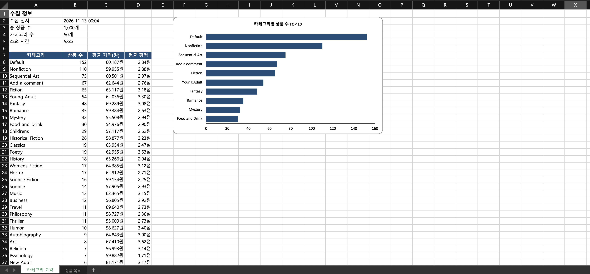
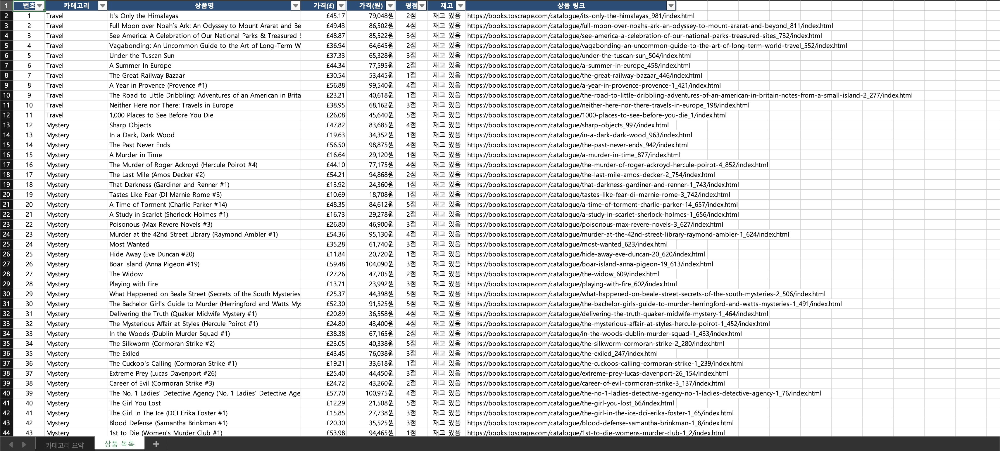
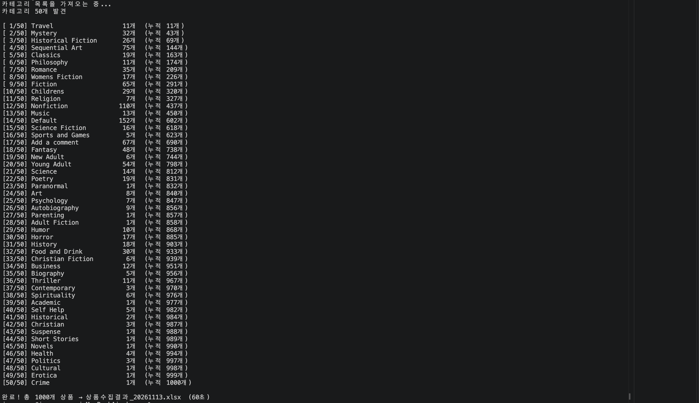

# 쇼핑몰 상품 정보 자동 수집기

쇼핑몰의 전체 상품 정보를 자동으로 수집해 엑셀 리포트로 정리하는 프로그램입니다.

## 주요 기능
- 50개 카테고리, 상품 1,000개 자동 수집 (약 1분)
- 상품명, 가격(원화 환산), 평점, 재고, 링크 정리
- 카테고리별 평균 가격·평점 요약 및 차트 자동 생성
- 필터·틀 고정이 적용된 엑셀 파일로 저장

## 결과 화면

## 실행 방법
pip3 install requests beautifulsoup4 openpyxl
python3 book_price_crawler.py

## 사용 기술
Python, requests, BeautifulSoup, openpyxl

※ 크롤링 연습용으로 공개된 예시 사이트(books.toscrape.com)를 대상으로 한 샘플입니다.
